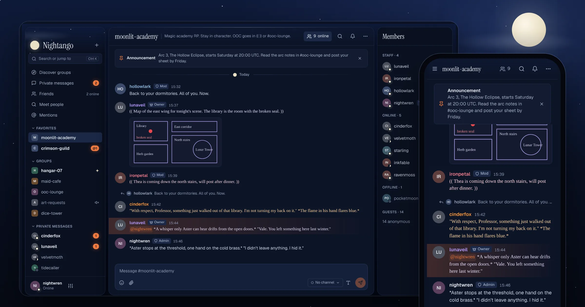
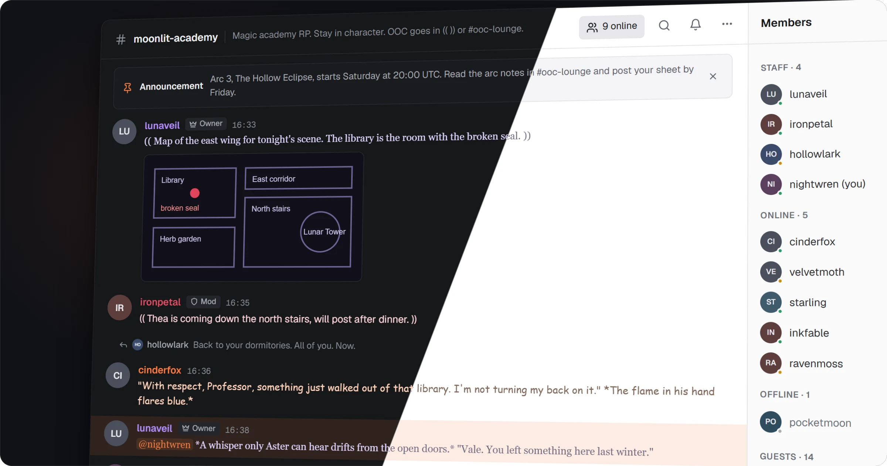
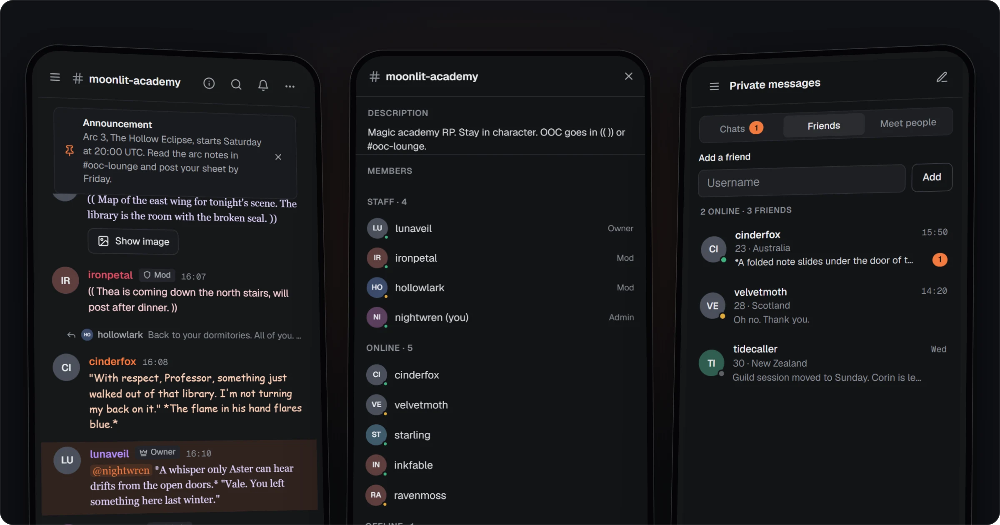
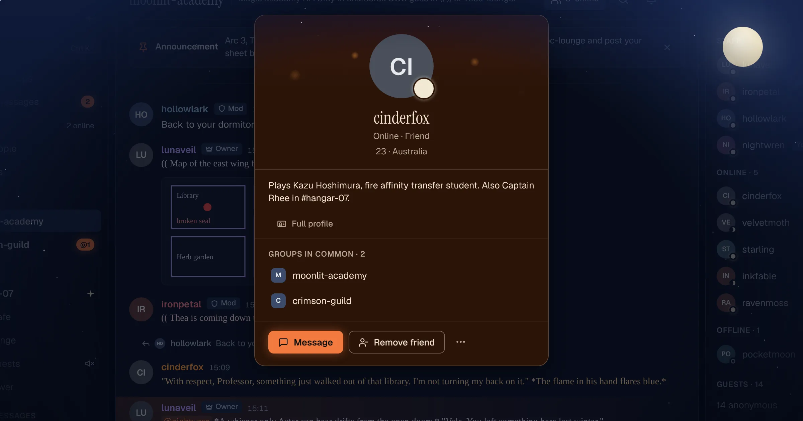
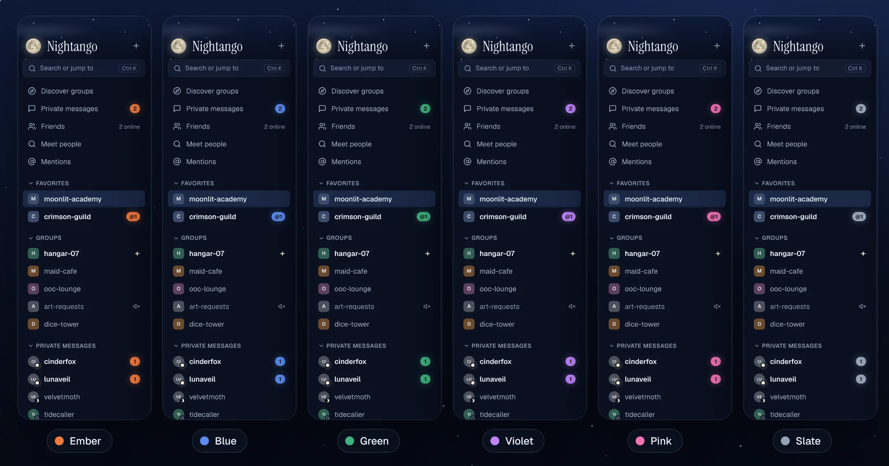

# Nightango



Nightango is a skin for [Torch](https://vissle.me), a third-party web client for Chatango. It is a Tampermonkey userscript for [st.chatango.com](https://st.chatango.com/): it starts Torch, then draws a redesigned interface on top of it: group chats, private messages, profiles, moderation and Meet people, on desktop and on phones.

You sign in on Torch's own screen. Nightango never reads your password and only sends Chatango frames that Torch or a reference library already uses.

## A night sky

Nightango is themed after a full-moon night with scattered clouds, and a torch under it.

- **The real moon.** The moon in the corner is tonight's moon, at its real phase, computed on your device. Every day divider in a conversation shows the moon of that night.
- **Two lights.** Cool moonlight frames the interface. Warm ember, the torch, marks only what asks for you: unread counts, mentions, the send button.
- **Presence by moon phase.** Online is a full moon, idle a crescent, offline a new moon. The shape tells the status, so it reads without relying on color.
- **Night and dawn.** The dark theme is the night sky. The light theme is the same sky at first light.
- Conversations always sit on solid panels. The sky stays around them.

## Features

**Group chats**
- Replies, mentions and unread markers, with a "New messages" jump.
- A Mentions page lists recent messages that mention you across your groups, and jumps to each one.
- Red, blue and staff channels, with a color bar on every channel message.
- Older messages load as you scroll up.
- Errors and warnings show as short notices instead of filling the thread.
- Your Torch media library: star an image to save it, insert it from the Media tab or by typing `:name` then Tab, and import or export it in Torch's format.

**Private messages and friends**
- Images and videos show as soon as you send them.
- Swipe a friend to remove them or get notified when they come online.

**Profiles**
- Premium members' colors and background image cover the whole profile card.
- Tap a profile picture to see it in full.
- Full profiles open in an isolated frame that can't run scripts.

**Moderation**
- Bans and unbans, the moderation log, moderator roles, announcements, banned words and slow mode.

**Mobile**
- Group info and member list in a full-screen sheet, channel picker next to the message box, pull to refresh in Meet people.







## Customisation



Everything lives in Settings > Appearance and is saved on your device.

- **Theme**: night (dark), dawn (light), or follow the system.
- **Sky**: Calm sky stops the drifting clouds. Southern hemisphere draws the moon as it looks south of the equator.
- **Accent color**: Ember, Blue, Green, Violet, Pink, Slate, or any color you pick. Text on the accent is adjusted so it stays readable.
- **Density**: comfortable, or compact with no avatars and the time before the name.
- **Text size** for message text.
- **Chatango styles**: turn members' name colors, fonts and text colors, message backgrounds and profile backgrounds on or off. Hard-to-read colors are corrected. To hide the style of one member only, use Hide style in their message menu or profile.
- **Imported themes**: load a theme file (.json) from the old Torch theme editor and use its accent color.
- **Message style**: pick the font, size and colors of your own messages. It applies to what you send from Nightango in this browser and does not change your Chatango account style.

## Privacy and security

- Your password stays with Torch. Nightango never reads, stores, logs or sends it.
- Every HTTP call Nightango makes is listed in [docs/torch-protocol.md](docs/torch-protocol.md#appels-http-autorisés), and nothing outside that list is called.
- Member HTML is rebuilt from an allow list, never injected. Full profiles render in a sandboxed frame without scripts.
- Profile backgrounds, message backgrounds and full-size profile pictures load without sending a referrer.
- Trusted sites, listed in Settings > Safety and shared with Torch, open without a link warning and load their images, videos and audio without a click. Other sites follow your media settings.
- Fonts ship inside the userscript: no request to Google Fonts.
- Activity on your own profile is the only visitor data Nightango reads.

## Install

1. Install [Tampermonkey](https://www.tampermonkey.net/) in your browser.
2. Download `torch-skin.min.user.js` from the [latest release](https://github.com/marjoriedotdev/nightango/releases/latest), or build it yourself (see below).
3. In Tampermonkey, create a new script, or open your existing Nightango script (named Torch Skin before 0.18.0), and replace all of its content with the file. Save.
4. Open https://st.chatango.com/ and sign in on the Torch screen. Nightango appears once your session is open.

## Build and test

Requires Node.js and pnpm.

```
pnpm install
pnpm build            # writes dist/
pnpm test             # build, then every jsdom suite
pnpm test live_ui     # build, then one suite
```

`pnpm build` writes:
- `dist/torch-skin.min.user.js`: the userscript to install.
- `dist/torch-skin.user.js`: the same script, readable, for review.
- `dist/torch-client.html` and `dist/app.js`: a prototype with simulated data.

## Fonts

Geist, Geist Mono and Instrument Serif are embedded in the userscript and the prototype. They are released under the SIL Open Font License 1.1: copyright notice and license in [torchds/project/fonts/OFL.txt](torchds/project/fonts/OFL.txt), copied by the build under the userscript header.

## Credits

Nightango runs on top of [Torch](https://github.com/Vissle-Drissle/Torch-Client) by Vissle, released under the MIT license.

## Documentation

The project docs are written in French.

- [AGENTS.md](AGENTS.md): project rules, commands, releasing a version
- [GLOSSARY.md](GLOSSARY.md): domain vocabulary
- [docs/architecture.md](docs/architecture.md): code and build layout
- [docs/torch-protocol.md](docs/torch-protocol.md): how Torch and the Chatango protocol work
- [docs/coding-conventions.md](docs/coding-conventions.md): code and test conventions
- [docs/adr/](docs/adr/): architecture decisions
